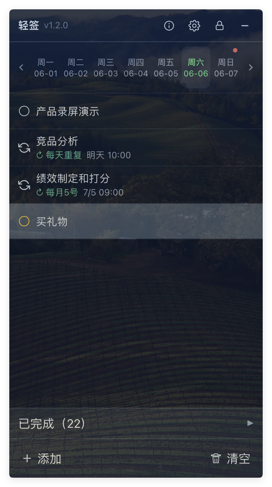
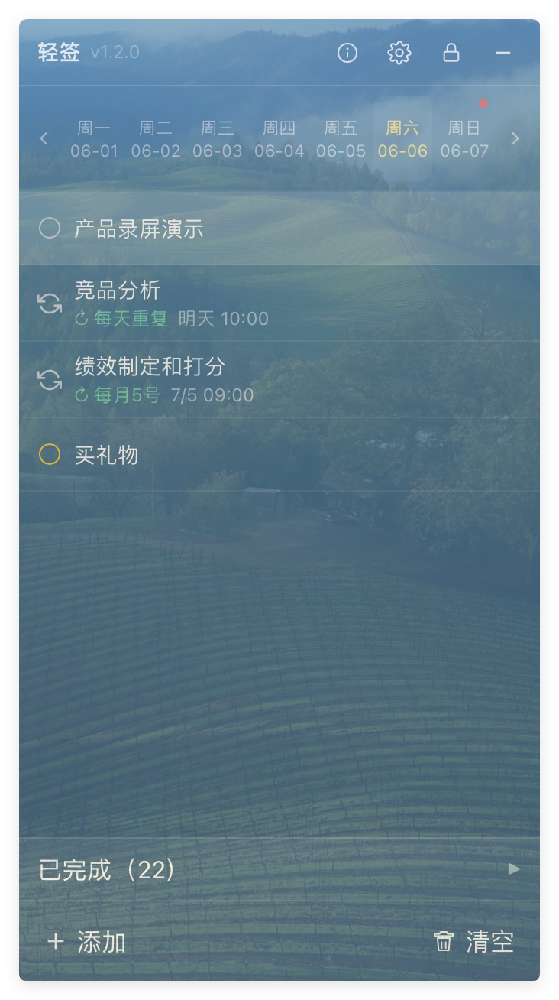
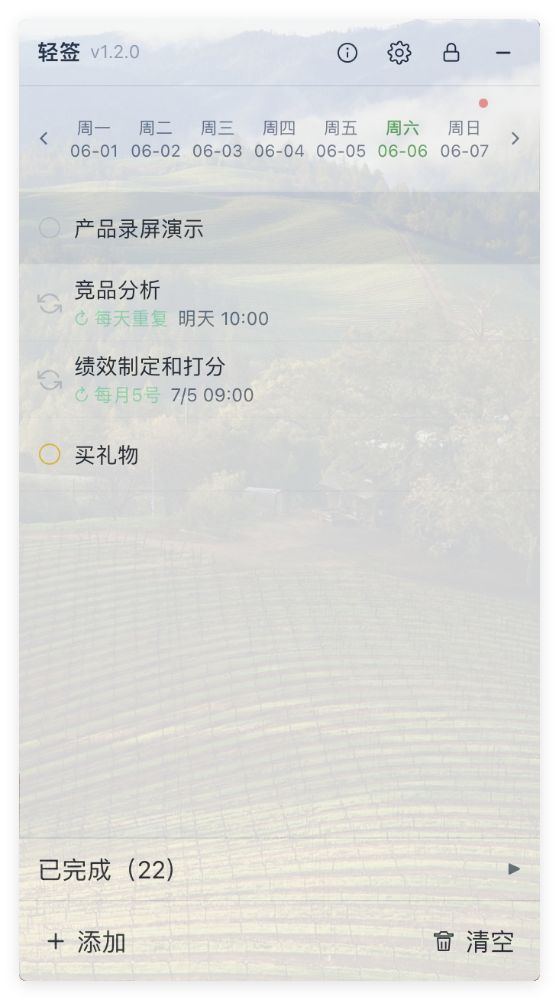

<!-- markdownlint-disable -->

<div align="center">


# 轻签 LiteNote

轻量、可定制的本地待办桌面小部件<br>
基于 Tauri 2 + React 构建

[反馈问题](https://github.com/SeaZhusp/LiteNote/issues) · [下载最新版](https://github.com/SeaZhusp/LiteNote/releases)

[](LICENSE)


</div>

---

## 为什么选择轻签

很多待办或笔记工具功能堆叠、体积偏大，不适合「贴在桌面、随手记一笔」。轻签专注 **本地待办** 小部件：无边框透明面板、托盘常驻、一键唤出，数据默认只留在本机（可选开启 WebDAV 同步），适合日常清单与桌面常驻。

## 功能特点

- **本地待办** — SQLite 存储，支持创建/编辑/完成/删除、置顶、四档重要程度颜色、截止时间、拖拽排序，数据默认仅存本机

- **备注与进度** — 每条待办可添加备注和 0–100% 进度，列表中直接显示进度标签

- **循环待办** — 支持每天 / 每周（可多选星期）/ 每月（可多选日期）重复，可自定义提醒时间，到期自动进入下一轮

- **到期提醒** — 提前提醒时间可自定义（1–1440 分钟）；支持右上角弹窗提醒（不抢焦点，可「稍后提醒」/「我知道了」）或系统通知

- **周日历** — 顶部周一到周日日历条，可切换周，点击筛选当日待办；红点标记有待办的日期，橙色点标记逾期任务

- **拖拽分配日期** — 拖拽待办到日历上的日期，自动设置截止时间；也可一键「复制到」其他日期

- **专注模式** — 只保留待办清单的极简悬浮窗，一键在专注 / 完整模式间切换

- **桌面小部件体验** — 无边框透明毛玻璃、面板透明度可调、自定义背景图片、窗口置顶、窗口锁定防误拖、隐藏到系统托盘

- **时钟与农历** — 大字号时钟 + 农历、日期、星期，可折叠隐藏

- **多主题切换** — 内置毛玻璃、深色、浅色三套主题，一键切换

- **可自定义快捷键** — 显示/隐藏窗口、专注模式、窗口置顶均可自定义（默认 `Ctrl+Shift+L` / `Ctrl+Shift+F` / `Ctrl+Shift+P`，macOS 为 `⌘`）

- **WebDAV 同步** — 内置坚果云预设，支持后台每 5 分钟双向合并同步（按更新时间 last-write-wins）、立即上传、从云端恢复

- **导出待办** — 一键导出为 txt 文本，未完成与已完成分区列出

- **内嵌设置** — 常规（透明度、背景、提醒方式与提前量、主题、语言、开机启动）、快捷键、同步三个分页，全部在主窗口内完成

- **跨平台** — 支持 Windows（NSIS 安装包 + 绿色便携版）与 macOS（`.app` / `.dmg`）

<p align="center">
  &nbsp;
  &nbsp;
  &nbsp;
</p>

## 应用场景

- 桌面常驻的轻量待办清单
- 游戏、看视频时随手记待办，或专注模式只盯当前待办
- 周期性提醒事项（每天喝水、每周例会、每月还款等）
- 有截止时间的事项提醒（弹窗 / 系统通知）
- 多设备之间用坚果云（WebDAV）同步待办

## 下载安装

前往 [GitHub Releases](https://github.com/SeaZhusp/LiteNote/releases) 下载最新版本。

> **Windows 用户注意：** 部分精简版/企业版 Windows 10 可能未安装 WebView2 运行时。安装包已内置引导下载，若仍有问题请手动安装 [WebView2 Runtime](https://developer.microsoft.com/microsoft-edge/webview2/)。

## 从源码构建

### 环境要求

- [Node.js](https://nodejs.org/) 18+ 与 [pnpm](https://pnpm.io/)
- [Rust](https://www.rust-lang.org/tools/install) stable
- [Tauri CLI 2](https://v2.tauri.app/)（通过 `pnpm tauri` 调用即可）

**Windows 额外需要：** Microsoft C++ Build Tools (MSVC) + Windows SDK

**macOS 额外需要：** Xcode Command Line Tools

### 步骤

```bash
git clone https://github.com/SeaZhusp/LiteNote.git
cd LiteNote

pnpm install

# 开发模式（Tauri + 前端热更新）
pnpm tauri dev

# 仅前端预览（无 Tauri API）
pnpm dev
```

## Star History

[](https://star-history.com/#SeaZhusp/LiteNote&Date)

## 贡献

欢迎通过 [Issue](https://github.com/SeaZhusp/LiteNote/issues) 反馈问题或提交 Pull Request。

## 许可证

本项目采用 [MIT](LICENSE) 许可证。
